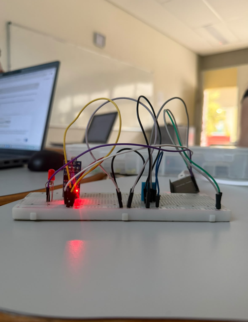

# ⋆ MONITORAMENTO AMBIENTAL ⋆
Sistema IOT com ESP32 para coleta de temperatura, umidade e luminosidade em tempo real, com envio para API e visualização em site com gráficos interativos.

## ⋆ Imagens do Projeto
<p align="center">
  
</p>

## ⋆ Objetivo do Desafio
1. Ler temperatura e umidade com DHT11 e luminosidade com LDR
2. Enviar dados via HTTP POST para API a cada 1 minuto
3. Armazenar dados em banco de dados relacional ou não relacional
4. Exibir histórico em site com gráficos interativos (Chart.js / D3.js)

## ⋆ MER / DER

**Tabela: Medicao**

| Campo | Tipo | Atributo |
| :--- | :--- | :--- |
| id | INT | PK, Autoincrement |
| data | DATETIME | default NOW() |
| temperatura | FLOAT | NOT NULL |
| umidade | FLOAT | NOT NULL |
| luminosidade | FLOAT | NOT NULL |

**DER:** ESP32 -> (POST) -> API -> Banco Medicao -> (GET) -> Site/Dashboard


## ⋆ Código - Protótipo IoT
```cpp
#include <WiFi.h>
#include <HTTPClient.h>
#include "DHT.h"

// Wi-Fi
const char* ssid = "TI_SENAI2";
const char* senha = "senai2025";

// API
const char* servidor = "http://192.168.1.101:3000/comandos";

// Sensores
#define DHTPIN 22
#define DHTTYPE DHT11

const int ldrPin = 4;
const int ledPin = 23;

DHT dht(DHTPIN, DHTTYPE);

// Controle de envio
unsigned long ultimoEnvio = 0;
const unsigned long intervalo = 60000;


// Conectar Wi-Fi
void conectarWiFi() {

  WiFi.mode(WIFI_STA);
  WiFi.begin(ssid, senha);

  Serial.println("Conectando ao Wi-Fi...");

  unsigned long inicio = millis();

  while (WiFi.status() != WL_CONNECTED &&
         millis() - inicio < 10000) {
    delay(500);
    Serial.print(".");
  }

  Serial.println();

  if (WiFi.status() == WL_CONNECTED) {
    Serial.println("Wi-Fi conectado!");
  } else {
    Serial.println("Wi-Fi nao conectado.");
  }
}


// Enviar dados para API
void enviarDados(float temperatura,
                 float umidade,
                 float luminosidade) {

  if (WiFi.status() != WL_CONNECTED) {
    Serial.println("Sem Wi-Fi. Dados nao enviados.");
    return;
  }

  HTTPClient http;

  http.begin(servidor);
  http.addHeader("Content-Type", "application/json");
  http.setTimeout(5000);

  String json = "{";
  json += "\"temperatura\":" + String(temperatura, 2) + ",";
  json += "\"umidade\":" + String(umidade, 2) + ",";
  json += "\"luminosidade\":" + String(luminosidade, 2);
  json += "}";

  int resposta = http.POST(json);

  if (resposta >= 200 && resposta < 300) {
    Serial.println("Dados enviados para API!");
  } else {
    Serial.print("Erro no envio: ");
    Serial.println(resposta);
  }

  http.end();
}


void setup() {

  Serial.begin(115200);
  Serial.println("O ESP32 Esta funcionando");

  dht.begin();
  pinMode(ledPin, OUTPUT);
  pinMode(ldrPin, INPUT);

  conectarWiFi();

  // Permite o primeiro envio imediatamente
  ultimoEnvio = millis() - intervalo;
}


void loop() {

  // Enviar a cada 1 minuto
  if (millis() - ultimoEnvio >= intervalo) {

    ultimoEnvio = millis();

    float h = dht.readHumidity();
    float t = dht.readTemperature();
    float f = dht.readTemperature(true);

    if (isnan(h) || isnan(t) || isnan(f)) {
      Serial.println("Sem receber dados do sensor DHT11");
      return;
    }

    // Ler luminosidade
    int ldrValue = analogRead(ldrPin);
    ldrValue = map(ldrValue, 0, 5000, 30, 0);

    // Mostrar no Monitor Serial
    Serial.print("Umidade: ");
    Serial.print(h);
    Serial.println("%");

    Serial.print("Temperatura: ");
    Serial.print(t);
    Serial.println(" C");

    Serial.print("Luminosidade: ");
    Serial.println(ldrValue);

    // Controle do LED
    if (ldrValue < 26) {
      digitalWrite(ledPin, HIGH);
    } else {
      digitalWrite(ledPin, LOW);
    }

    // Enviar para API
    enviarDados(t, h, ldrValue);

    Serial.println("-------------------------");
  }

  // Reconectar Wi-Fi
  if (WiFi.status() != WL_CONNECTED) {
    static unsigned long ultimaTentativa = 0;

    if (millis() - ultimaTentativa >= 10000) {
      ultimaTentativa = millis();
      WiFi.reconnect();
    }
  }
}